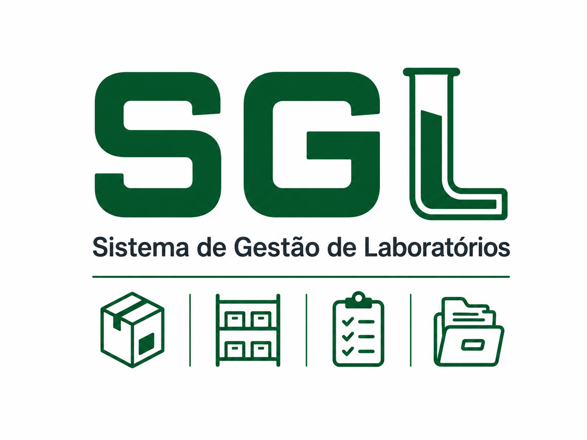
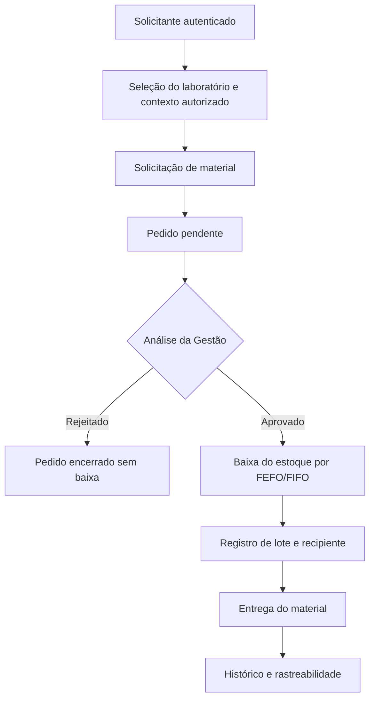
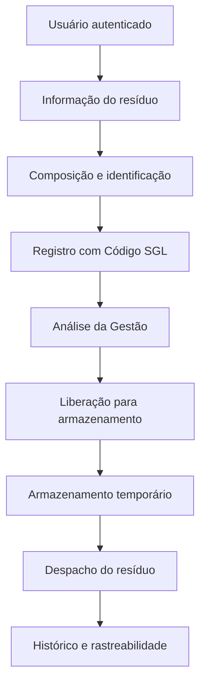

<a id="readme-top"></a>

<div align="center">
  

# SGL — Sistema de Gestão de Laboratórios

**Backend que centraliza o controle de estoque e automatiza processos para tornar a gestão de laboratórios mais organizada, eficiente e rastreável.**

`Java 17` · `Spring Boot 4.1` · `PostgreSQL` · `Flyway` · `Swagger/OpenAPI` · `PDF/XLSX`

</div>

## O que é o SGL?

**O SGL é uma plataforma de gestão de laboratórios que centraliza e automatiza processos, materiais e responsabilidades envolvidos na operação de um ou de vários laboratórios.**

Seu propósito vai além de consultar saldos ou acompanhar solicitações. O SGL conecta o **ciclo dos materiais** — desde o cadastro e a entrada no estoque até a liberação e as movimentações — às pessoas responsáveis por essas operações. Assim, a Gestão consegue saber o que está disponível, quem pode utilizar cada material e como seu uso é registrado.

Esse acompanhamento também alcança os resíduos e a identificação física dos materiais, oferecendo suporte à auditoria e à fiscalização, especialmente quando são necessários cuidados específicos de armazenamento e manuseio.

### A necessidade que deu origem ao projeto

O SGL nasceu de um problema concreto apresentado pela equipe responsável da **organização dos estoques e materiais dos laboratórios de uma Unidade da Embrapa**. A rotina dependia de **diversas planilhas e controles dispersos** para cadastros, saldos, entradas, saídas e acompanhamento de materiais. Além disso, a equipe precisava administrar pedidos e entregas, utilizando **um sistema genérico de terceiros** para parte das solicitações.

Em uma Unidade com vários laboratórios, esse trabalho não se limita a registrar produtos: envolve saber **quais materiais estão disponíveis, onde estão armazenados, quem pode solicitá-los, quem os liberou, como foram utilizados e o que precisa ser reposto, identificado ou fiscalizado**. Manter essas informações em ferramentas separadas exigia conciliação manual e dificultava uma visão integrada da operação.

Essa integração também precisa considerar **quem está autorizado a solicitar materiais e a qual laboratório eles se destinam**. Quando uma solicitação está associada a um projeto institucional, o SGL utiliza a hierarquia **Projeto → SCI → Atividade**: um Projeto reúne SCIs, cada SCI possui suas Atividades, e as participações e os vínculos das pessoas ajudam a determinar os laboratórios elegíveis. Essa estrutura serve para **contextualizar e rastrear o uso dos materiais**, não para gerenciar o conteúdo ou os resultados das pesquisas. As relações são apresentadas em mais detalhes no [modelo de domínio](#modelo-de-domínio--relações-fundamentais).

Na prática, a gestão passa a acompanhar o caminho de um material **desde o cadastro e a entrada física até sua autorização, movimentação, eventual devolução e registro para auditoria**. A integração com serviços corporativos da Embrapa permite aproveitar a identidade institucional dos usuários, enquanto o backend mantém as regras de autorização e a consistência das operações.

**Este repositório** contém a API do SGL: regras de negócio, autorização, transações de estoque, persistência e evolução do banco de dados. A interface utilizada por solicitantes e gestores está no [SGL-FRONTEND](https://github.com/gbsalermo/SGL-FRONTEND).

**Quem utiliza:** solicitantes (empregados e estagiários), orientadores e equipes de Gestão/Administração. O acesso e as ações disponíveis dependem do perfil, da Unidade e dos vínculos.

| Problema real | Resposta do SGL |
|---|---|
| Catálogos, saldos, entradas, saídas e alertas de estoque acompanhados em controles separados | Cadastro de produtos, estoque central por Unidade, indicadores de estoque baixo, vencimentos e histórico de movimentações |
| Lotes e recipientes com validade, diferentes apresentações e uso parcial | Controle físico por lote e recipiente, seleção FEFO/FIFO, fracionamento e rastreabilidade de baixas e devoluções |
| Pedidos de produtos em ferramenta externa e preparo de soluções tratado separadamente | Solicitação, análise, aprovação e entrega de materiais integradas ao estoque; solicitação e preparo de soluções em fluxo próprio |
| Pessoas e laboratórios vinculados a diferentes projetos, SCIs e atividades | Gestão de estagiários, orientadores, vínculos e participações para definir quem pode solicitar materiais em cada laboratório |
| Resíduos, identificação de materiais e fiscalização sem visão operacional integrada | Registros de resíduos e composição, rótulos, histórico e informações de apoio à identificação física e à fiscalização |
| Unidades e perfis com responsabilidades diferentes | Autenticação corporativa, controle de acesso por perfil e segregação de dados por Unidade |
| Conferência manual de informações e emissão de documentos | Painéis operacionais, relatórios PDF/XLSX, rótulos e documentos de entrada |

**Estado atual:** o SGL está **em produção** e segue em evolução contínua. **Versão do backend:** [**1.26.11-3**](https://git-cnpmf.nuvem.ti.embrapa.br/nti/sgl-api/tags/1.26.11-3). Informações detalhadas sobre arquitetura, decisões de implementação e melhorias em andamento estão disponíveis na [documentação técnica](docs/README.md).

## Objetivo

O objetivo do SGL é **centralizar e automatizar a gestão de materiais e estoques laboratoriais**, oferecendo à administração uma visão integrada dos recursos disponíveis, de sua utilização e das pessoas envolvidas nas operações.

Ao substituir controles dispersos por processos conectados, o sistema busca simplificar a rotina dos gestores, reduzir a dependência de registros manuais e garantir maior consistência nas informações. Cada operação passa a compor um histórico rastreável, permitindo acompanhar o uso dos materiais, identificar necessidades de reposição e apoiar decisões administrativas.

Mais do que organizar o estoque, o SGL procura estabelecer uma **gestão laboratorial estruturada, segura e auditável**, na qual a movimentação dos materiais esteja associada às autorizações, responsabilidades e procedimentos da instituição.

### Principais funcionalidades

- **Gestão de estoque:** catálogo de produtos, entradas e saídas, lotes e recipientes, fracionamento, vencimentos, estoque mínimo e seleção FEFO/FIFO.
- **Pedidos de materiais:** solicitação, análise, aprovação, entrega e devolução, com movimentações vinculadas ao estoque físico.
- **Soluções laboratoriais:** cadastro e modelos, solicitações, preparação e entrega em fluxo próprio.
- **Gestão de estagiários e vínculos:** acompanhamento de orientadores, participações e laboratórios autorizados, incluindo contextos de Projeto, SCI e Atividade.
- **Resíduos laboratoriais:** informação de resíduos, composição, avaliação, armazenamento e destinação.
- **Identificação e fiscalização:** rótulos de produtos, soluções e resíduos, documentos de entrada e rastreabilidade dos materiais.
- **Relatórios e indicadores:** consultas operacionais, histórico de movimentações, alertas e exportações PDF/XLSX.
- **Administração institucional:** organização de Unidades e laboratórios, perfis de acesso e integração com a identidade corporativa.

---

## Fluxos operacionais do SGL

O SGL integra diferentes processos da rotina laboratorial, desde a solicitação de materiais até o registro e acompanhamento de resíduos. Cada operação possui regras próprias de autorização, movimentação e rastreabilidade.

Os fluxogramas abaixo representam **dois exemplos de utilização do sistema**, não a totalidade dos processos, funcionalidades ou caminhos possíveis.

### Exemplo 1 — Solicitação de material



*Exemplo do pedido de material. A criação não altera o estoque; a baixa ocorre na aprovação.*

### Exemplo 2 — Informação de resíduo laboratorial



*Exemplo do ciclo de um resíduo. Informar sua composição não gera automaticamente uma baixa no estoque de produtos.*

Os exemplos demonstram como o SGL relaciona as operações aos usuários responsáveis, preservando informações que auxiliam a Gestão no controle e na fiscalização dos materiais.

---

## Diferenciais e decisões que definem o SGL

O SGL foi construído para representar a realidade da gestão laboratorial, na qual controlar um material significa mais do que saber sua quantidade disponível. Algumas decisões de modelagem são fundamentais para essa proposta:

- **O estoque representa materiais físicos, não apenas números.** O controle considera lotes, recipientes, validade, apresentações e consumo parcial. As regras FEFO/FIFO e de fracionamento permitem registrar de onde o material saiu e evitar a abertura desnecessária de recipientes.

- **A solicitação respeita o contexto de quem utiliza o laboratório.** Cada solicitação leva em consideração as informações do solicitante, os materiais envolvidos e o contexto em que serão utilizados. Empregados e estagiários não seguem exatamente as mesmas regras: a participação de um estagiário em Projeto, SCI ou Atividade pode definir os laboratórios elegíveis para seus pedidos. Essa estrutura contextualiza o uso dos materiais, sem gerenciar a pesquisa em si.

- **Aprovar, movimentar e entregar não são a mesma coisa.** Em um pedido de material, a aprovação é o momento da baixa física, enquanto a entrega conclui o atendimento sem descontar novamente. Quando um cancelamento com restituição é permitido, o sistema utiliza o histórico das saídas para preservar a origem das quantidades devolvidas.

- **Produtos, soluções e resíduos têm naturezas diferentes.** Os produtos constituem a base do catálogo e dos pedidos de materiais, cuja aprovação pode gerar saídas do estoque físico. As soluções possuem um fluxo próprio de solicitação, preparação e entrega; os resíduos, por sua vez, são informados, analisados e acompanhados até o armazenamento e a destinação. Cada domínio preserva suas regras sem ser tratado como uma variação de um mesmo cadastro.

- **A gestão de estagiários vai além do cadastro de pessoas.** O sistema acompanha orientadores, períodos de vínculo, treinamento de segurança e participações em atividades, incluindo a possibilidade de associação a mais de um laboratório. Assim, a Gestão acompanha a situação do estagiário e as condições de sua atuação nos laboratórios.

- **A rastreabilidade acompanha a operação.** Movimentações, responsáveis, lotes, recipientes, identificação física e documentos permitem reconstruir o histórico dos materiais e apoiar a conferência e a fiscalização, em vez de depender apenas de registros manuais posteriores.

- **O sistema se adapta à estrutura institucional.** A integração com a identidade corporativa, a separação por Unidade e o tratamento de perfis e vínculos permitem operar em um ambiente com vários laboratórios. O backend concentra as regras de negócio e as validações das operações; a interface organiza a experiência de cada usuário. A **arquitetura multi-tenant por Unidade** utiliza o contexto da sessão autenticada para delimitar as operações e consultas institucionais.

- **As interfaces acompanham o papel de cada usuário.** Quem solicita um material encontra uma jornada voltada ao pedido e ao acompanhamento; quem o analisa e gerencia o estoque dispõe de ações e informações próprias da Gestão. Orientadores e administradores também acessam experiências adequadas às suas atribuições, sem transformar a mesma tela em um painel genérico para todos.

- **Os dashboards priorizam o que precisa de atenção.** Os painéis reúnem indicadores úteis à rotina, como pedidos pendentes, estoque baixo, vencimentos, movimentações e resíduos aguardando ações, oferecendo à Gestão uma visão rápida das necessidades operacionais.

- **Os relatórios refletem diferentes conjuntos de informações.** Em vez de uma consulta única e genérica, o SGL organiza relatórios específicos para estoque e lotes, movimentações, produtos, projetos, estagiários, resíduos e fiscalização, com filtros e exportações que apoiam conferências e decisões administrativas.

Essas decisões são o que conecta **estoque, pessoas e processos em uma gestão laboratorial integrada**. A descrição técnica dos mecanismos e as verificações de segurança ainda em andamento estão no [dossiê do projeto](docs/DOSSIE_PROJETO_SGL.md) e no [registro de revisão](docs/REGISTRO_PENDENCIAS_REVISAO_SGL_2026-11.md).

---

## Arquitetura

```text
HTTP / REST
     ↓
Controller
     ↓ RequestDTO / ResponseDTO
Service
     ↓
Repository
     ↓
PostgreSQL + Flyway
```

Responsabilidades:

```text
Controller  → contrato HTTP e validação de entrada
Service     → regra de negócio, transação e orquestração
Repository  → persistência e consultas
Model       → estado do domínio
DTO         → contrato público da API
```

### Identificadores

```text
Long id
→ interno: banco, JPA, FKs e locks

UUID publicId
→ público: DTOs, endpoints e frontend
```

Os contratos públicos da API utilizam UUID como identificador das entidades; os IDs numéricos internos permanecem na persistência.

---

### Como backend e frontend se conectam

```text
Solicitante / Orientador / Gestão / Administração
                    │ navegador
                    ▼
        Vue 3 + TypeScript (SGL-FRONTEND)
                    │ HTTPS, mesmo host
             Nginx: /api → sgl-api
                    │
                    ▼
      Spring Boot REST + JWT + TenantContext
          │                   │
  regras de negócio     gateway corporativo
          │             (integração institucional)
          ▼
    JPA + PostgreSQL 16
      │
    Flyway (V1–V48)
```

A infraestrutura de implantação versionada utiliza **containers separados para web e API**, Nginx servindo a SPA e encaminhando `/api` ao backend, além do PostgreSQL. A interface, a API e os vídeos da Ajuda têm ciclos de implantação distintos. O desenho de staging deve usar redes, volumes, banco e credenciais **isolados**, sem reutilizar a instalação institucional.

---

## Multitenancy por Unidade

A Unidade do SGL é delimitada pela **identidade autenticada e pelo JWT**, com políticas de `TenantRequestFilter`, `TenantContext` e services/repositories no backend.

```text
Login corporativo / JWT
→ usuário ativo e Unidade corporativa habilitada
→ TenantRequestFilter obtém a Unidade da sessão
→ TenantContext restringe consultas e operações por Unidade
```

O header `X-SGL-Unidade-Id` **não identifica livremente o tenant**: ele só é admitido para `ADMINISTRADOR_GERAL` selecionar outra Unidade autorizada. Fluxos `dev/demo` são exclusivos desses profiles e não constituem autenticação de produção.

**Auditoria de autorização ainda aberta:** filtragem por Unidade não substitui autorização por objeto para dados de outro usuário da mesma Unidade. Consultas de Pedidos, Estagiários, Resíduos, Usuários e Relatórios precisam de testes de acesso por titular/perfil, conforme [registro único de pendências](docs/REGISTRO_PENDENCIAS_REVISAO_SGL_2026-11.md).
---

## Modelo de domínio — relações fundamentais

O domínio possui **relações hierárquicas e associações multilaboratório**; por isso, não é fiel reduzi-lo a uma árvore onde todo Projeto pertence necessariamente a um único Laboratório.

```text
Unidade
  ├─ Laboratórios                 ← mais de um por Projeto/pessoa, conforme vínculo
  ├─ Pessoas / perfis / vínculos  ← autorização e histórico
  └─ Estoque Central
       └─ Produto → Lote → Recipiente → Movimentação

Projeto ↔ Laboratório(s)
   └─ SCI
       └─ Atividade ← Participação do estagiário

Pedido de material / Pedido de solução
   ├─ solicitante + Laboratório de destino
   ├─ contexto Projeto/SCI/Atividade quando aplicável
   └─ itens e transições (aprovação, preparo/entrega/cancelamento)

Resíduo
   ├─ gerador + Laboratório + contexto quando aplicável
   ├─ composição de catálogo e/ou livre
   └─ análise, armazenamento e destinação
```

| Entidade/conceito | Significado |
|---|---|
| **Unidade e Laboratório** | Tenant institucional e locais operacionais, com laboratórios múltiplos autorizados |
| **Projeto / SCI / Atividade** | Contexto de pesquisa hierárquico; pode relacionar diferentes laboratórios |
| **Vínculo / Participação** | Período institucional e elegibilidade operacional da pessoa, especialmente do estagiário |
| **EstoqueCentral / Produto** | Saldo por Unidade e item de catálogo com unidade de controle |
| **Lote / Recipiente** | Validade, embalagem, estado físico de abertura e fração consumível |
| **Movimentação** | Histórico auditável de entradas, saídas, devoluções e descartes por origem física |
| **Pedido / Solução / Resíduo** | Processos com regras e ciclos de vida próprios; não são entidades intercambiáveis |

Na implementação, os identificadores `Long` sustentam JPA/FKs internamente e `UUID publicId` atravessa DTOs e endpoints. Este é um **mapa conceitual**: os relacionamentos e cardinalidades definitivos estão nas entidades, migrations e [dossiê técnico](docs/DOSSIE_PROJETO_SGL.md).

---

## Estoque, FIFO e FEFO

```text
produto perecível     → FEFO
produto não perecível → FIFO
```

Invariantes:

```text
EstoqueCentral.quantidadeAtual acompanha os lotes
aprovação baixa estoque
entrega não baixa novamente
cancelamento aprovado restaura os lotes exatos
lote vencido não é elegível para aprovação
movimentação identifica o lote efetivamente afetado
```

Formas de retirada atuais:

```text
UNITARIO
KIT
CAIXA
GARRAFA
GALAO
```

Fracionamento:

```text
false → true  permitido
true  → false não permitido
```

---

## Pedidos

```text
PENDENTE
├── APROVADO
│   ├── ENTREGUE
│   └── CANCELADO
└── REJEITADO
```

A aprovação realiza a baixa física. A entrega apenas conclui o fluxo. O cancelamento de pedido aprovado restaura as quantidades dos lotes utilizados. Urgência não altera FIFO/FEFO.

---

## Resíduos

Decisão de domínio:

```text
Produto != Resíduo
```

Uma composição de Resíduo pode referenciar Produto para rastreabilidade, sem movimentar estoque automaticamente.

Fluxo:

```text
INFORMADO
→ EM_ANALISE
→ LIBERADO_PARA_ARMAZENAMENTO
→ ARMAZENADO_TEMPORARIAMENTE
→ DESPACHADO
```

Código SGL:

```text
SGL-RES-AAAA-NNNNNN
```

Detalhes: [`docs/MODULO_RESIDUOS.md`](docs/MODULO_RESIDUOS.md).

---

## Relatórios

Relatórios implementados e presentes na `release` (com homologação integrada e equivalência de filtros ainda pendentes):

```text
Estagiários
Produtos
Projetos — consolidação de SCI, Atividades e participações
Movimentações — Resumo / Detalhamento
Estoque e lotes
Fiscalização
Resíduos
Pessoas por laboratório
```

A Central apresenta **Movimentações** com modos Resumo (contagens de ocorrências, sem rankings) e Detalhamento (filtros por tipo, origem, contexto Projeto/SCI/Atividade, produto, apresentação/unidade e período). As quantidades físicas têm unidades identificadas e exibição opcional no Detalhamento e na exportação PDF/XLSX. **Estoque e lotes** informam apresentação, conteúdo e recipientes fechados, abertos ou esgotados. **Fiscalização** apresenta a trilha de movimentações com recipientes vinculados.

A classificação histórica de consumo como apresentação completa ou por medida é derivada das parcelas registradas, sem afirmar a intenção original da solicitação. Os endpoints anteriores de Movimentações e Resumo Operacional permanecem disponíveis.

A interface encaminha filtros para consultas e exportações PDF/XLSX. A equivalência de resultados para todas as combinações ainda deve ser validada; há riscos de desempenho e uma divergência semântica de unidades físicas em um DTO de Resumo Operacional registrados na auditoria.

Pedidos entregues continuam sendo um recorte de Movimentações, não um relatório separado.

---

## Identidade e controle de acesso

```text
login corporativo (autenticacaoapi + Empregado/Colaboradorapi)  ✅
sessão JWT própria (HS256, 5 h, só publicId)                     ✅
usuário recarregado do banco a cada requisição                   ✅
Unidade derivada da sessão                                       ✅
X-SGL-Unidade-Id aceito só do ADMINISTRADOR_GERAL                ✅
pendentes, aprovação, recusa e importação pela gestão            ✅
regras de concessão de perfil (PerfilPolicy)                     ✅
log de auditoria (logger sgl.auditoria)                          ✅
matriz completa de permissões por módulo                         ⏳ roadmap item 1
```

O fluxo atual de autenticação e seus testes estão mapeados no [dossiê técnico](docs/DOSSIE_PROJETO_SGL.md). Planos de autenticação datados permanecem como contexto histórico, não substituem o código da `release`.

### Autenticação corporativa

- `POST /api/v1/auth/login` valida login de rede (ou CPF, para colaboradores) e senha na `autenticacaoapi`, resolve a pessoa na Empregadoapi/Colaboradorapi, sincroniza o `Usuario` e devolve o JWT. **Empregado novo** pode ser registrado como `ATIVO` com perfil sugerido; **colaborador/estagiário novo** recebe `PENDENTE_VINCULACAO` até a regularização pela Gestão. Pessoa importada pela Gestão pode ser criada ativa, respeitando concessão de perfis e vínculos.
- `GET /api/v1/auth/me` devolve o usuário da sessão; `GET /api/v1/auth/config` informa se o login DEV está ativo.
- `POST /api/v1/auth/dev-login` existe **só** nos perfis `dev` e `demo` e aceita apenas usuários de origem `DEV` (massa de exemplo).
- O CPF nunca sai em resposta HTTP do SGL; nos logs aparece sempre mascarado. Senha nunca é gravada nem logada.
- "Sair" é feito no cliente (o JWT é descartado); um token roubado vale até expirar (5 h), mas deixa de funcionar na hora se o usuário for desativado.

Variáveis de ambiente (nenhum valor real em arquivo versionado):

```text
SPRING_PROFILES_ACTIVE     sem padrão: dev/demo só em máquina de desenvolvimento ou apresentação
SGL_CORPORATE_BASE_URL     gateway das APIs corporativas (padrão dev: https://api-gateway-devhomol.nuvem.ti.embrapa.br)
SGL_CORPORATE_AMBIENTE     h (homologação) ou p (produção)
SGL_CORPORATE_USERNAME     usuário de sistema (Basic Auth)
SGL_CORPORATE_PASSWORD     senha do usuário de sistema
SGL_JWT_SECRET             segredo HS256 com 32+ bytes (o valor padrão de dev não serve para produção)
SGL_PRIMEIRO_LOGIN_ADMIN   true só no primeiro deploy: o primeiro login vira ADMINISTRADOR_GERAL (uso único; padrão false)
```

Em `dev` e `demo` a aplicação sobe sem as credenciais corporativas; nesse caso o login corporativo responde 503 e o login DEV continua disponível.

Primeiro acesso de um ambiente novo: subir com `SGL_PRIMEIRO_LOGIN_ADMIN=true`, entrar com a própria conta da Embrapa (vira Administrador geral) e desligar a variável no deploy seguinte. Depois disso, a variável não tem mais efeito enquanto existir algum `ADMINISTRADOR_GERAL`, ativo ou não.

O Administrador geral habilita novas Unidades em `POST /api/v1/unidades/habilitar` (lista em `GET /api/v1/unidades/corporativas`); login de pessoa de Unidade não habilitada é recusado com `UNIDADE_NAO_HABILITADA`.

Regras de servidor além da autenticação:

- `POST/PUT/DELETE /api/v1/unidades`: só `ADMINISTRADOR_GERAL`.
- Vínculos operacionais, laboratório-base, estágios e edição de usuários: só gestão, respeitando a regra de concessão de perfis; ninguém altera o próprio perfil, situação ou laboratório.
- Rotas que ainda recebem o usuário que age (`usuarioId` no corpo ou na query: pedidos, movimentações de estoque, prorrogações, correção de código SEG, observações de estágio) recusam com 403 qualquer valor diferente do usuário da sessão.
- A matriz completa de permissões por módulo continua sendo o item 1 do roadmap.

---

## Banco e migrations

Ambiente de desenvolvimento padrão:

```text
PostgreSQL
Hibernate ddl-auto=validate
Flyway habilitado
```

O Flyway versiona e aplica as alterações de esquema do banco. Cada evolução é registrada em uma nova migration, preservando o histórico das versões já aplicadas.

A `release` consultada contém **48 migrations SQL, V1 a V48**, em `src/main/resources/db/migration/`; V47/V48 cobrem vínculos multilaboratório e sinalização de laboratório fora dos vínculos do solicitante. A aplicação em produção usa validação de esquema e Flyway. A **presença de migration no Git não prova que foi aplicada numa instância**. O perfil `test` usa H2, `create-drop` e Flyway desabilitado; a homologação das migrations sobre PostgreSQL permanece aberta.

---

## Execução local

**A partir da raiz do repositório** (com Java 17 e variáveis de banco/credenciais apropriadas):

```bash
./mvnw spring-boot:run -Dspring-boot.run.profiles=dev
```

No Windows, usar `mvnw.cmd` ou terminal que execute `./mvnw`. O perfil `dev` é **somente local**; configurar PostgreSQL isolado e nunca usar dados institucionais para testes destrutivos.

```text
API local:  http://localhost:8080/api/v1
Swagger:    http://localhost:8080/swagger-ui/index.html
OpenAPI:    http://localhost:8080/v3/api-docs
```

Testes existentes (não executados nesta revisão):

```bash
./mvnw test
./mvnw verify
```

Esses comandos não substituem a verificação PostgreSQL/Flyway, segurança horizontal, carga, frontend E2E e impressão em hardware real, descritas no [plano de homologação](docs/PLANO_HOMOLOGACAO_NUVEM_MOBILE_2026-11-17.md).
---

## Evolução do projeto — referência de 17/11/2026

**A branch `release` já incorpora os fluxos que antigas anotações de outubro descreviam como pendentes.** A comparação técnica está nos dossiês; o quadro não substitui testes executados.

| Ciclo | Estado verificado por leitura do código |
|---|---|
| Etapas 1–6 | Bases operacionais, Projetos/SCI/Atividades, Estagiários/vínculos e fluxos históricos incorporados |
| Etapa 7 | Estoque físico, lote/recipiente, FEFO/FIFO, fracionamento e Soluções incorporados |
| Etapa 8 | Contextos elegíveis e Pedidos com regras distintas para empregados e estagiários incorporados |
| Etapa 9 | Relatórios consolidados, filtros e exportação PDF/XLSX presentes na `release` |
| Etapa 10 | Rótulos de Produto/Resíduo/Solução e documento de entrada presentes; impressão física Zebra **não homologada** nesta auditoria |
| Estagiários multilaboratório | V47/V48 e contratos de múltiplos laboratórios presentes; regressão E2E pendente |
| Etapas 12–13 de qualidade | Auditoria documental avançada, **execução de arquitetura/carga/E2E e homologação cloud/mobile pendentes** |

**Portões em aberto:** matriz de autorização por registro, migrações reais em PostgreSQL, testes completos, carga, integração corporativa e navegação Android/iOS por estagiários. [31 itens rastreados](docs/REGISTRO_PENDENCIAS_REVISAO_SGL_2026-11.md) não equivalem a 31 defeitos confirmados: incluem riscos, decisões, divergências e testes futuros.
---

### Como o projeto evoluiu

A evolução não foi apenas visual: cada ciclo incorporou uma restrição nova do domínio e obrigou as camadas a permanecerem coerentes.

```text
Protótipo e identidade de interface
  → cadastros e gestão de resíduos
  → hierarquia Projeto / SCI / Atividade e estágio
  → estoque físico por lotes e recipientes (FEFO/FIFO)
  → Pedidos e Soluções com contexto e baixa transacional
  → Relatórios, rótulos e impressão
  → identidade institucional com JWT e multilaboratório
  → auditoria e homologação integrada (fase atual de qualidade)
```

**Aprendizados documentados:** decisões de modelagem, migrations, conciliação entre frontend/backend, regressões identificadas e revisões de permissões estão preservadas nos [dossiês](docs/DOSSIE_PROJETO_SGL.md) e na [matriz técnica](docs/MATRIZ_COERENCIA_FRONTEND_BACKEND_2026-11-12.md). Não atribuímos métricas de adoção, economia ou performance que ainda não foram medidas ou publicadas.

---

## Documentação

| Documento | Papel |
|---|---|
| [`CONTINUIDADE.md`](CONTINUIDADE.md) | Estado e regra de retomada |
| [`docs/README.md`](docs/README.md) | Índice atual e documentos especializados |
| [`docs/DOSSIE_PROJETO_SGL.md`](docs/DOSSIE_PROJETO_SGL.md) | Mapa técnico consolidado |
| [`docs/GOVERNANCA_DOCUMENTAL.md`](docs/GOVERNANCA_DOCUMENTAL.md) | Precedência de documentos e histórico |
| [`docs/MATRIZ_COERENCIA_FRONTEND_BACKEND_2026-11-12.md`](docs/MATRIZ_COERENCIA_FRONTEND_BACKEND_2026-11-12.md) | Evidências estáticas frontend/backend |
| [`docs/REGISTRO_PENDENCIAS_REVISAO_SGL_2026-11.md`](docs/REGISTRO_PENDENCIAS_REVISAO_SGL_2026-11.md) | **Fila única** de riscos, decisões e correções posteriores |
| [`docs/ETAPA_12_PLANO_QUALIDADE_ARQUITETURA_CARGA_E2E.md`](docs/ETAPA_12_PLANO_QUALIDADE_ARQUITETURA_CARGA_E2E.md) | Testes transversais planejados |
| [`docs/PLANO_HOMOLOGACAO_NUVEM_MOBILE_2026-11-17.md`](docs/PLANO_HOMOLOGACAO_NUVEM_MOBILE_2026-11-17.md) | Ensaios CL-01–11 e MB-01–12, **não executados** |
| [`docs/AUDITORIA_REFERENCIAS_E_SINCRONIZACAO_2026-11-17.md`](docs/AUDITORIA_REFERENCIAS_E_SINCRONIZACAO_2026-11-17.md) | Links, workflows e checklist de MR |
| [`docs/SINCRONIZACAO_GITLAB_GITHUB.md`](docs/SINCRONIZACAO_GITLAB_GITHUB.md) | GitLab `release`, GitHub espelho, sincronizações e MRs |

Os documentos de etapa e exemplos antigos são **registros históricos**. Quando houver conflito, prevalecem o **código `release` verificado**, contratos OpenAPI e governança atuais. Nenhuma mudança funcional foi feita nesta revisão documental.
