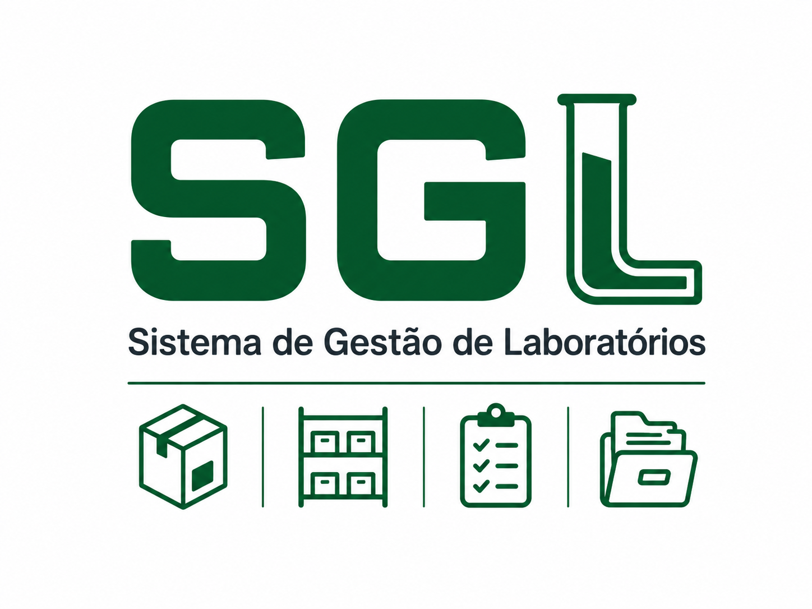

<a id="readme-top"></a>

<div align="center">
  

# SGL — Sistema de Gestão de Laboratórios

**Backend corporativo para pedidos, estoque por lotes, rastreabilidade, resíduos, fiscalização, vínculos institucionais, cadastros e relatórios laboratoriais.**

`Java 17` · `Spring Boot 4.1` · `PostgreSQL` · `Flyway` · `Swagger/OpenAPI` · `PDF/XLSX`

</div>

## O que é o SGL?

O **SGL (Sistema de Gestão de Laboratórios)** é uma plataforma de apoio à organização, execução e acompanhamento das atividades laboratoriais. Seu propósito é reunir em um mesmo ambiente a estrutura dos laboratórios, os projetos e suas atividades, o controle de materiais, as solicitações, os resíduos e as informações necessárias à gestão.

O sistema foi concebido para dar **rastreabilidade às operações**, reduzir controles dispersos e oferecer uma visão consistente dos recursos utilizados por diferentes laboratórios de uma instituição. Cada Unidade possui seu contexto operacional, enquanto Projetos, SCI, Atividades e vínculos permitem relacionar pessoas e operações às suas origens.

No backend, isso se traduz em serviços e regras de negócio para:

- **Materiais e estoque:** catálogo de produtos, entrada de lotes, recipientes, apresentações, fracionamento, critérios FEFO/FIFO e movimentações auditáveis.
- **Solicitações e soluções:** pedidos de materiais e de soluções, validação dos contextos operacionais, aprovação, preparo, entrega e tratamento das quantidades utilizadas.
- **Projetos e pessoas:** organização de Projetos, SCI e Atividades, vínculos de usuários, participações de Estagiários e histórico operacional.
- **Resíduos e segurança:** registro, classificação, acompanhamento, tratamento e destinação de resíduos, além de informações de riscos e fiscalização.
- **Gestão e relatórios:** consultas, indicadores, rastreabilidade e exportação de dados em PDF/XLSX.

A API concentra validações, transações e regras de consistência; a interface web utiliza esses contratos para permitir a operação cotidiana. O SGL está em **evolução de pré-produção**: a integração de identidade institucional e a autorização definitiva são previstas para fases próprias, não devendo ser confundidas com a sessão de desenvolvimento.

> **Acompanhamento da evolução:** o histórico de entregas, o estado de cada etapa e os próximos passos estão em [`CONTINUIDADE.md`](CONTINUIDADE.md) e [`docs/PLANO_PRE_PRODUCAO.md`](docs/PLANO_PRE_PRODUCAO.md). O histórico da Etapa 9 está documentado em [`docs/ETAPA_9_INICIO_RELATORIOS_CONSOLIDADOS_2026-10-26.md`](docs/ETAPA_9_INICIO_RELATORIOS_CONSOLIDADOS_2026-10-26.md).

---

## Objetivo

O SGL representa o ciclo operacional dos laboratórios de forma rastreável:

```text
estrutura institucional
→ catálogo de produtos
→ estoque central por Unidade
→ entrada de lotes
→ solicitação de material
→ aprovação
→ baixa física FIFO/FEFO
→ entrega
→ movimentações auditáveis
→ geração e destinação de resíduos
→ relatórios/fiscalização
→ administração de dados-base
```

As regras de estoque (FEFO/FIFO), as transições operacionais e os cálculos oficiais são executados pelo backend. O frontend apresenta e conduz as operações usando os contratos da API.

---

## Arquitetura

```text
HTTP / REST
     ↓
Controller
     ↓ RequestDTO / ResponseDTO
Service
     ↓
Repository
     ↓
PostgreSQL + Flyway
```

Responsabilidades:

```text
Controller  → contrato HTTP e validação de entrada
Service     → regra de negócio, transação e orquestração
Repository  → persistência e consultas
Model       → estado do domínio
DTO         → contrato público da API
```

### Identificadores

```text
Long id
→ interno: banco, JPA, FKs e locks

UUID publicId
→ público: DTOs, endpoints e frontend
```

Os contratos públicos da API utilizam UUID como identificador das entidades; os IDs numéricos internos permanecem na persistência.

---

## Multitenancy por Unidade

O SGL organiza os registros operacionais por Unidade, com delimitação aplicada nas consultas e nos serviços.

Fluxo atual:

```text
frontend lê unidadeId da sessão DEV
→ envia X-SGL-Unidade-Id
→ TenantRequestFilter valida o UUID
→ TenantContext mantém a Unidade durante a requisição
→ services/repositories restringem os dados da Unidade
```

No ambiente de desenvolvimento, o contexto da Unidade é informado pelo cabeçalho `X-SGL-Unidade-Id`, associado à sessão DEV. Esse fluxo viabiliza a validação funcional por Unidade; a identidade e a autorização corporativas não fazem parte dessa sessão.

**Na integração institucional**, a Unidade (tenant) será resolvida a partir da identidade autenticada na sessão/token institucional e aplicada pelo backend.

---

## Domínio principal

```text
Unidade
├── Laboratórios
│   ├── Usuários
│   ├── Estagiários
│   ├── Projetos
│   ├── Pedidos
│   └── Resíduos
└── Estoque Central
    └── Produto
        └── Lotes
            └── Movimentações
```

Conceitos centrais:

- **Produto:** catálogo e unidade-base de controle;
- **EstoqueCentral:** saldo consolidado por produto/Unidade;
- **Lote:** quantidade física, validade, embalagem, multiplicador e rastreabilidade;
- **MovimentacaoEstoque:** trilha das operações físicas;
- **Pedido:** solicitação e ciclo de aprovação/entrega;
- **Resíduo:** material gerado no laboratório e encaminhado à Gestão;
- **Estagiário:** identidade institucional ligada a vínculos históricos; contexto operacional vem das participações em Atividades, que derivam Projeto/Laboratório dentro da Unidade;
- **Fiscalização:** classificação explícita de produtos controlados.

---

## Estoque, FIFO e FEFO

```text
produto perecível     → FEFO
produto não perecível → FIFO
```

Invariantes:

```text
EstoqueCentral.quantidadeAtual acompanha os lotes
aprovação baixa estoque
entrega não baixa novamente
cancelamento aprovado restaura os lotes exatos
lote vencido não é elegível para aprovação
movimentação identifica o lote efetivamente afetado
```

Formas de retirada atuais:

```text
UNITARIO
KIT
CAIXA
GARRAFA
GALAO
```

Fracionamento:

```text
false → true  permitido
true  → false não permitido
```

---

## Pedidos

```text
PENDENTE
├── APROVADO
│   ├── ENTREGUE
│   └── CANCELADO
└── REJEITADO
```

A aprovação realiza a baixa física. A entrega apenas conclui o fluxo. O cancelamento de pedido aprovado restaura as quantidades dos lotes utilizados. Urgência não altera FIFO/FEFO.

---

## Resíduos

Decisão de domínio:

```text
Produto != Resíduo
```

Uma composição de Resíduo pode referenciar Produto para rastreabilidade, sem movimentar estoque automaticamente.

Fluxo:

```text
INFORMADO
→ EM_ANALISE
→ LIBERADO_PARA_ARMAZENAMENTO
→ ARMAZENADO_TEMPORARIAMENTE
→ DESPACHADO
```

Código SGL:

```text
SGL-RES-AAAA-NNNNNN
```

Detalhes: [`docs/MODULO_RESIDUOS.md`](docs/MODULO_RESIDUOS.md).

---

## Relatórios

Relatórios implementados e validados funcionalmente na branch da Etapa 9:

```text
Estagiários
Produtos
Projetos — consolidação de SCI, Atividades e participações
Movimentações — Resumo / Detalhamento
Estoque e lotes
Fiscalização
Resíduos
Pessoas por laboratório
```

A Central apresenta **Movimentações** com modos Resumo (contagens de ocorrências, sem rankings) e Detalhamento (filtros por tipo, origem, contexto Projeto/SCI/Atividade, produto, apresentação/unidade e período). As quantidades físicas têm unidades identificadas e exibição opcional no Detalhamento e na exportação PDF/XLSX. **Estoque e lotes** informam apresentação, conteúdo e recipientes fechados, abertos ou esgotados. **Fiscalização** apresenta a trilha de movimentações com recipientes vinculados.

A classificação histórica de consumo como apresentação completa ou por medida é derivada das parcelas registradas, sem afirmar a intenção original da solicitação. Os endpoints anteriores de Movimentações e Resumo Operacional permanecem disponíveis.

Os relatórios utilizam consultas e filtros consistentes entre a prévia e as exportações PDF/XLSX.

Pedidos entregues continuam sendo um recorte de Movimentações, não um relatório separado.

---

## Identidade e controle de acesso

```text
login corporativo (autenticacaoapi + Empregado/Colaboradorapi)  ✅
sessão JWT própria (HS256, 5 h, só publicId)                     ✅
usuário recarregado do banco a cada requisição                   ✅
Unidade derivada da sessão                                       ✅
X-SGL-Unidade-Id aceito só do ADMINISTRADOR_GERAL                ✅
pendentes, aprovação, recusa e importação pela gestão            ✅
regras de concessão de perfil (PerfilPolicy)                     ✅
log de auditoria (logger sgl.auditoria)                          ✅
matriz completa de permissões por módulo                         ⏳ roadmap item 1
```

Spec e plano: `docs/superpowers/specs/2026-10-27-autenticacao-corporativa-design.md` e `docs/superpowers/plans/2026-10-27-autenticacao-corporativa.md` (no repositório `sistema_sgl`).

### Autenticação corporativa

- `POST /api/v1/auth/login` valida login de rede (ou CPF, para colaboradores) e senha na `autenticacaoapi`, resolve a pessoa na Empregadoapi/Colaboradorapi, sincroniza o `Usuario` e devolve o JWT. Pessoa nova entra como `PENDENTE_VINCULACAO` e só acessa `/api/v1/auth/me` até um gestor da Unidade aprová-la; pessoa importada pela gestão entra direto.
- `GET /api/v1/auth/me` devolve o usuário da sessão; `GET /api/v1/auth/config` informa se o login DEV está ativo.
- `POST /api/v1/auth/dev-login` existe **só** nos perfis `dev` e `demo` e aceita apenas usuários de origem `DEV` (massa de exemplo).
- O CPF nunca sai em resposta HTTP do SGL; nos logs aparece sempre mascarado. Senha nunca é gravada nem logada.
- "Sair" é feito no cliente (o JWT é descartado); um token roubado vale até expirar (5 h), mas deixa de funcionar na hora se o usuário for desativado.

Variáveis de ambiente (nenhum valor real em arquivo versionado):

```text
SPRING_PROFILES_ACTIVE     sem padrão: dev/demo só em máquina de desenvolvimento ou apresentação
SGL_CORPORATE_BASE_URL     gateway das APIs corporativas (padrão dev: https://api-gateway-devhomol.nuvem.ti.embrapa.br)
SGL_CORPORATE_AMBIENTE     h (homologação) ou p (produção)
SGL_CORPORATE_USERNAME     usuário de sistema (Basic Auth)
SGL_CORPORATE_PASSWORD     senha do usuário de sistema
SGL_JWT_SECRET             segredo HS256 com 32+ bytes (o valor padrão de dev não serve para produção)
SGL_PRIMEIRO_LOGIN_ADMIN   true só no primeiro deploy: o primeiro login vira ADMINISTRADOR_GERAL (uso único; padrão false)
```

Em `dev` e `demo` a aplicação sobe sem as credenciais corporativas; nesse caso o login corporativo responde 503 e o login DEV continua disponível.

Primeiro acesso de um ambiente novo: subir com `SGL_PRIMEIRO_LOGIN_ADMIN=true`, entrar com a própria conta da Embrapa (vira Administrador geral) e desligar a variável no deploy seguinte. Depois disso, a variável não tem mais efeito enquanto existir algum `ADMINISTRADOR_GERAL`, ativo ou não.

O Administrador geral habilita novas Unidades em `POST /api/v1/unidades/habilitar` (lista em `GET /api/v1/unidades/corporativas`); login de pessoa de Unidade não habilitada é recusado com `UNIDADE_NAO_HABILITADA`.

Regras de servidor além da autenticação:

- `POST/PUT/DELETE /api/v1/unidades`: só `ADMINISTRADOR_GERAL`.
- Vínculos operacionais, laboratório-base, estágios e edição de usuários: só gestão, respeitando a regra de concessão de perfis; ninguém altera o próprio perfil, situação ou laboratório.
- Rotas que ainda recebem o usuário que age (`usuarioId` no corpo ou na query: pedidos, movimentações de estoque, prorrogações, correção de código SEG, observações de estágio) recusam com 403 qualquer valor diferente do usuário da sessão.
- A matriz completa de permissões por módulo continua sendo o item 1 do roadmap.

---

## Banco e migrations

Ambiente de desenvolvimento padrão:

```text
PostgreSQL
Hibernate ddl-auto=validate
Flyway habilitado
```

O Flyway versiona e aplica as alterações de esquema do banco. Cada evolução é registrada em uma nova migration, preservando o histórico das versões já aplicadas.

Migrations existentes nesta revisão: **V1 a V45**, em `src/main/resources/db/migration/` (V45 = identidade corporativa; preenche CNPMF com `codigo_corporativo = 7`). A aplicação utiliza validação do esquema via Hibernate, enquanto o Flyway mantém o histórico de alterações.

---

## Execução local

```bash
cd backend/sgl-backend
mvn spring-boot:run -Dspring-boot.run.profiles=dev
```

Variáveis usuais:

```text
DB_URL=jdbc:postgresql://localhost:5432/sgl
DB_USER=postgres
DB_PASSWD=<senha>
```

Acessos locais:

```text
API        http://localhost:8080
Swagger    http://localhost:8080/swagger-ui/index.html
OpenAPI    http://localhost:8080/v3/api-docs
```

Testes:

```bash
mvn test
```

---

## Evolução do projeto

O desenvolvimento de pré-produção evolui de forma incremental, preservando os fluxos homologados. A Etapa 9 está validada funcionalmente na branch colaborativa, mas ainda não integrada à `main`:

| Etapa | Escopo | Situação |
|---|---|---|
| 1–4 | Padrão visual, experiência inicial, Resíduos e expansão operacional | Concluídas |
| 5 | Projetos, SCI e Atividades | Concluída |
| 6 | Estagiários, vínculos, participações e formação | Concluída |
| 7 | Estoque físico, apresentações, fracionamento, FEFO/FIFO e Soluções | Concluída |
| 8 | Contextos operacionais, Pedidos, Soluções, Resíduos e vínculos adicionais | Concluída e integrada |
| 9 | Relatórios consolidados: Projetos, Movimentações (Resumo/Detalhamento), Estoque/Lotes e Fiscalização | Implementada e validada funcionalmente; aguardando merge |
| 10 | Rótulos e impressão operacional | Planejada |
| 11 | Manual do usuário e revisão de inativação/delete lógico | Planejada |
| 12 | Testes transversais de arquitetura, carga, E2E e regressão | Planejada |
| 13 | Revisão estrutural e auditoria final integral | Planejada |

**Preparação para produção:** após a estabilização funcional, o plano contempla matriz de permissões, congelamento, homologação integrada, correções, identidade e autorização definitivas, integração institucional e liberação controlada.

O detalhamento das decisões, entregas e critérios de validação fica em [`CONTINUIDADE.md`](CONTINUIDADE.md) e no [plano de pré-produção](docs/PLANO_PRE_PRODUCAO.md). Este README apresenta a arquitetura e as capacidades do sistema; não substitui os checkpoints técnicos.

---

## Documentação

| Documento | Uso |
|---|---|
| [`CONTINUIDADE.md`](CONTINUIDADE.md) | checkpoint atual e regra de retomada |
| [`docs/DOSSIE_PROJETO_SGL.md`](docs/DOSSIE_PROJETO_SGL.md) | visão consolidada do sistema |
| [`docs/README.md`](docs/README.md) | índice e classificação documental |
| [`docs/MODULO_RESIDUOS.md`](docs/MODULO_RESIDUOS.md) | domínio de resíduos |
| [`docs/RELATORIOS.md`](docs/RELATORIOS.md) | relatórios atuais |
| [`docs/EXPORTACAO_RELATORIOS.md`](docs/EXPORTACAO_RELATORIOS.md) | exportações PDF/XLSX |
| [`docs/PENDENCIAS_POS_PROTOTIPO.md`](docs/PENDENCIAS_POS_PROTOTIPO.md) | pendências/refactors posteriores |

> Exemplos e documentos históricos são auxiliares. Em caso de conflito, prevalecem `main`, Swagger/OpenAPI e os documentos atuais indicados acima.
