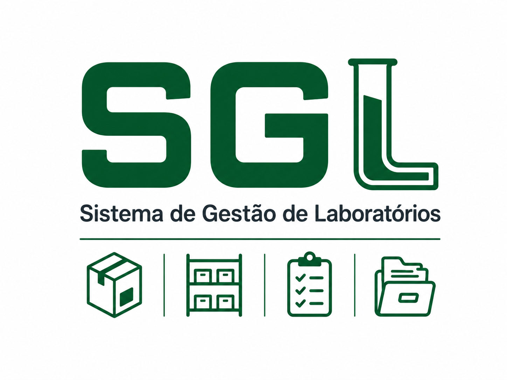

<a id="readme-top"></a>

<div align="center">
  

# SGL — Sistema de Gestão de Laboratórios

**Backend corporativo para pedidos, estoque por lotes, rastreabilidade, resíduos, fiscalização, vínculos institucionais, cadastros e relatórios laboratoriais.**

`Java 17` · `Spring Boot 4.1` · `PostgreSQL` · `Flyway` · `Swagger/OpenAPI` · `PDF/XLSX`

</div>

## O que é o SGL?

O **SGL (Sistema de Gestão de Laboratórios)** é uma plataforma de apoio à organização, execução e acompanhamento das atividades laboratoriais. Seu propósito é reunir em um mesmo ambiente a estrutura dos laboratórios, os projetos e suas atividades, o controle de materiais, as solicitações, os resíduos e as informações necessárias à gestão.

O sistema foi concebido para dar **rastreabilidade às operações**, reduzir controles dispersos e oferecer uma visão consistente dos recursos utilizados por diferentes laboratórios de uma instituição. Cada Unidade possui seu contexto operacional, enquanto Projetos, SCI, Atividades e vínculos permitem relacionar pessoas e operações às suas origens.

No backend, isso se traduz em serviços e regras de negócio para:

- **Materiais e estoque:** catálogo de produtos, entrada de lotes, recipientes, apresentações, fracionamento, critérios FEFO/FIFO e movimentações auditáveis.
- **Solicitações e soluções:** pedidos de materiais e de soluções, validação dos contextos operacionais, aprovação, preparo, entrega e tratamento das quantidades utilizadas.
- **Projetos e pessoas:** organização de Projetos, SCI e Atividades, vínculos de usuários, participações de Estagiários e histórico operacional.
- **Resíduos e segurança:** registro, classificação, acompanhamento, tratamento e destinação de resíduos, além de informações de riscos e fiscalização.
- **Gestão e relatórios:** consultas, indicadores, rastreabilidade e exportação de dados em PDF/XLSX.

A API concentra validações, transações e regras de consistência; a interface web utiliza esses contratos para permitir a operação cotidiana. O SGL está em **evolução de pré-produção**: a integração de identidade institucional e a autorização definitiva são previstas para fases próprias, não devendo ser confundidas com a sessão de desenvolvimento.

> **Acompanhamento da evolução:** o histórico de entregas, o estado de cada etapa e os próximos passos estão em [`CONTINUIDADE.md`](CONTINUIDADE.md) e [`docs/PLANO_PRE_PRODUCAO.md`](docs/PLANO_PRE_PRODUCAO.md). A Etapa 9 está documentada em [`docs/ETAPA_9_INICIO_RELATORIOS_CONSOLIDADOS_2026-10-26.md`](docs/ETAPA_9_INICIO_RELATORIOS_CONSOLIDADOS_2026-10-26.md).

---

## Objetivo

O SGL representa o ciclo operacional dos laboratórios de forma rastreável:

```text
estrutura institucional
→ catálogo de produtos
→ estoque central por Unidade
→ entrada de lotes
→ solicitação de material
→ aprovação
→ baixa física FIFO/FEFO
→ entrega
→ movimentações auditáveis
→ geração e destinação de resíduos
→ relatórios/fiscalização
→ administração de dados-base
```

Regras críticas permanecem no backend; o frontend não deve recriar FIFO/FEFO, transições de domínio, validações oficiais ou cálculos de relatórios.

---

## Arquitetura

```text
HTTP / REST
     ↓
Controller
     ↓ RequestDTO / ResponseDTO
Service
     ↓
Repository
     ↓
PostgreSQL + Flyway
```

Responsabilidades:

```text
Controller  → contrato HTTP e validação de entrada
Service     → regra de negócio, transação e orquestração
Repository  → persistência e consultas
Model       → estado do domínio
DTO         → contrato público da API
```

### Identificadores

```text
Long id
→ interno: banco, JPA, FKs e locks

UUID publicId
→ público: DTOs, endpoints e frontend
```

Novos contratos públicos devem continuar usando UUID.

---

## Multitenancy por Unidade

A `main` possui isolamento operacional por Unidade.

Fluxo atual:

```text
frontend lê unidadeId da sessão DEV
→ envia X-SGL-Unidade-Id
→ TenantRequestFilter valida o UUID
→ TenantContext mantém a Unidade durante a requisição
→ services/repositories restringem os dados da Unidade
```

Esse mecanismo é importante para validar a separação entre Unidades durante o desenvolvimento, mas **ainda não é a fronteira definitiva de segurança**, porque o cabeçalho é informado pelo cliente e o backend ainda não deriva a Unidade de uma identidade autenticada confiável.

Na etapa de autenticação corporativa, o tenant deverá vir da sessão/token institucional.

---

## Domínio principal

```text
Unidade
├── Laboratórios
│   ├── Usuários
│   ├── Estagiários
│   ├── Projetos
│   ├── Pedidos
│   └── Resíduos
└── Estoque Central
    └── Produto
        └── Lotes
            └── Movimentações
```

Conceitos centrais:

- **Produto:** catálogo e unidade-base de controle;
- **EstoqueCentral:** saldo consolidado por produto/Unidade;
- **Lote:** quantidade física, validade, embalagem, multiplicador e rastreabilidade;
- **MovimentacaoEstoque:** trilha das operações físicas;
- **Pedido:** solicitação e ciclo de aprovação/entrega;
- **Resíduo:** material gerado no laboratório e encaminhado à Gestão;
- **Estagiário:** identidade institucional ligada a vínculos históricos; contexto operacional vem das participações em Atividades, que derivam Projeto/Laboratório dentro da Unidade;
- **Fiscalização:** classificação explícita de produtos controlados.

---

## Estoque, FIFO e FEFO

```text
produto perecível     → FEFO
produto não perecível → FIFO
```

Invariantes:

```text
EstoqueCentral.quantidadeAtual acompanha os lotes
aprovação baixa estoque
entrega não baixa novamente
cancelamento aprovado restaura os lotes exatos
lote vencido não é elegível para aprovação
movimentação identifica o lote efetivamente afetado
```

Formas de retirada atuais:

```text
UNITARIO
KIT
CAIXA
GARRAFA
GALAO
```

Fracionamento:

```text
false → true  permitido
true  → false não permitido
```

---

## Pedidos

```text
PENDENTE
├── APROVADO
│   ├── ENTREGUE
│   └── CANCELADO
└── REJEITADO
```

A aprovação realiza a baixa física. A entrega apenas conclui o fluxo. O cancelamento de pedido aprovado restaura as quantidades dos lotes utilizados. Urgência não altera FIFO/FEFO.

---

## Resíduos

Decisão de domínio:

```text
Produto != Resíduo
```

Uma composição de Resíduo pode referenciar Produto para rastreabilidade, sem movimentar estoque automaticamente.

Fluxo:

```text
INFORMADO
→ EM_ANALISE
→ LIBERADO_PARA_ARMAZENAMENTO
→ ARMAZENADO_TEMPORARIAMENTE
→ DESPACHADO
```

Código SGL:

```text
SGL-RES-AAAA-NNNNNN
```

Detalhes: [`docs/MODULO_RESIDUOS.md`](docs/MODULO_RESIDUOS.md).

---

## Relatórios

Relatórios atualmente integrados:

```text
Estagiários
Produtos
Movimentações
Resumo operacional
Estoque e lotes
Fiscalização
Resíduos
Pessoas por laboratório
```

Prévia, PDF e XLSX devem representar a mesma consulta e os mesmos filtros.

Pedidos entregues continuam sendo um recorte de Movimentações, não um relatório separado.

---

## Segurança — estado correto

```text
Spring Security como base técnica                   ✅
sessão DEV no frontend                              ✅ temporária
isolamento operacional por Unidade                  ✅ desenvolvimento
guardas de rota por perfil                          ✅ UX
autenticação definitiva                             ⏳
autorização global no servidor                      ⏳
auditoria derivada da identidade autenticada        ⏳
integração corporativa/SSO                          ⏳
```

A configuração atual ainda permite requisições sem autenticação definitiva. Não tratar sessão DEV, perfil no frontend ou `X-SGL-Unidade-Id` como segurança final de produção.

---

## Banco e migrations

Ambiente de desenvolvimento padrão:

```text
PostgreSQL
Hibernate ddl-auto=validate
Flyway habilitado
```

A evolução do schema é responsabilidade do Flyway. Migrations aplicadas são imutáveis; novas alterações de banco devem usar uma nova versão.

Sequência atual:

```text
V1 ... V12
```

---

## Execução local

```bash
cd backend/sgl-backend
mvn spring-boot:run
```

Variáveis usuais:

```text
DB_URL=jdbc:postgresql://localhost:5432/sgl
DB_USER=postgres
DB_PASSWD=<senha>
```

Acessos locais:

```text
API        http://localhost:8080
Swagger    http://localhost:8080/swagger-ui/index.html
OpenAPI    http://localhost:8080/v3/api-docs
```

Testes:

```bash
mvn test
```

---

## Sequência de trabalho

### Agora — pré-produção pós-aprovação

```text
Etapa 1 — padrão visual global                 ✅
Etapa 2 — Dark Mode definitivo                 ✅
Etapa 3 — refinamentos do fluxo de Resíduos    ✅
Etapa 4 — expansão operacional de Resíduos     ✅
Etapa 5 — Projetos e Atividades                ✅ concluída e validada
Etapa 6 — Estagiários e vínculos               🔧 6.1–6.4 concluídos; 6.5 frontend próximo
Etapas 7 a 13                                  ⏳ sequenciais
```

### Depois — roadmap formal para produção

```text
1. matriz/diretrizes de permissões
2. congelamento funcional
3. homologação integrada final
4. correção de falhas de homologação
5. autenticação + autorização + auditoria definitiva
6. integração corporativa / SSO / resolução confiável de Unidade
7. documentos/upload quando o contrato estiver definido
8. refactors técnicos planejados
```

O roadmap formal não foi descartado; ele apenas começa **depois** do bloco atual de pré-produção.

---

## Documentação

| Documento | Uso |
|---|---|
| [`CONTINUIDADE.md`](CONTINUIDADE.md) | checkpoint atual e regra de retomada |
| [`docs/DOSSIE_PROJETO_SGL.md`](docs/DOSSIE_PROJETO_SGL.md) | visão consolidada do sistema |
| [`docs/README.md`](docs/README.md) | índice e classificação documental |
| [`docs/MODULO_RESIDUOS.md`](docs/MODULO_RESIDUOS.md) | domínio de resíduos |
| [`docs/RELATORIOS.md`](docs/RELATORIOS.md) | relatórios atuais |
| [`docs/EXPORTACAO_RELATORIOS.md`](docs/EXPORTACAO_RELATORIOS.md) | exportações PDF/XLSX |
| [`docs/PENDENCIAS_POS_PROTOTIPO.md`](docs/PENDENCIAS_POS_PROTOTIPO.md) | pendências/refactors posteriores |

> Exemplos e documentos históricos são auxiliares. Em caso de conflito, prevalecem `main`, Swagger/OpenAPI e os documentos atuais indicados acima.

---

<div align="center">
  <strong>SGL — Sistema de Gestão de Laboratórios</strong><br/>
  Sistema funcionalmente aprovado em preparação para o ciclo formal de produção.
</div>

### Estado atual do domínio de Estagiários

A Etapa 6 já consolidou:

- `Usuario → Estagiario → VinculoEstagio 1..N`;
- múltiplas participações históricas em Atividades;
- Formação como enum institucional + `OUTRO`;
- Curso como catálogo administrável por Unidade;
- treinamento de segurança no vínculo, iniciado em `false` e concluído por ação explícita;
- Cultura como catálogo por Unidade e associação N:N com `VinculoEstagioAtividade`;
- respostas de vínculo/Estagiário com Atividade → SCI → Projeto → Laboratório e Culturas;
- ausência de um único “Laboratório do Estagiário” como fonte operacional definitiva.

Checkpoint atual: `docs/VALIDACAO_ETAPA_6_3.md`.

